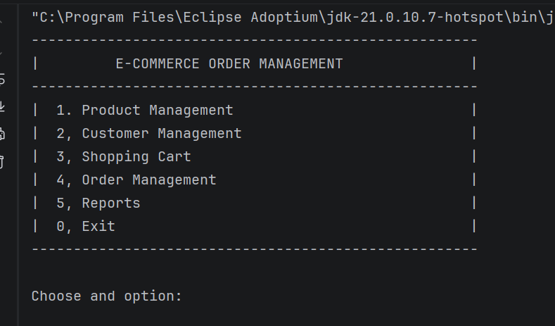
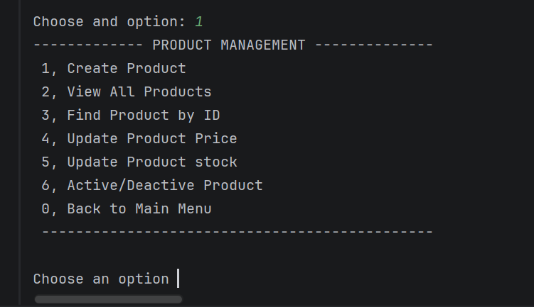
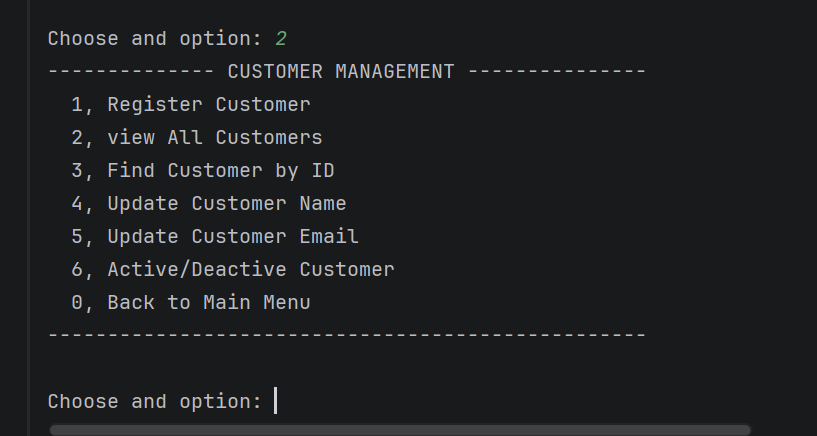
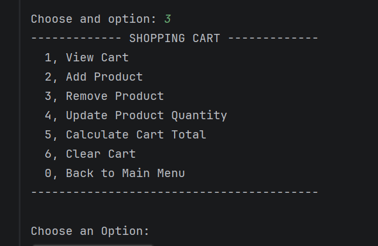
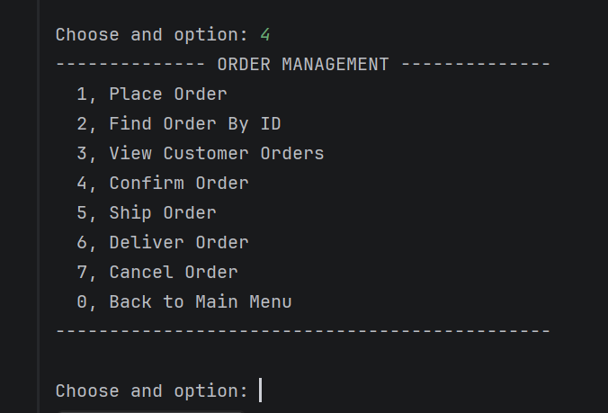
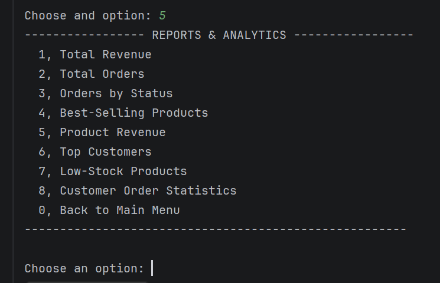
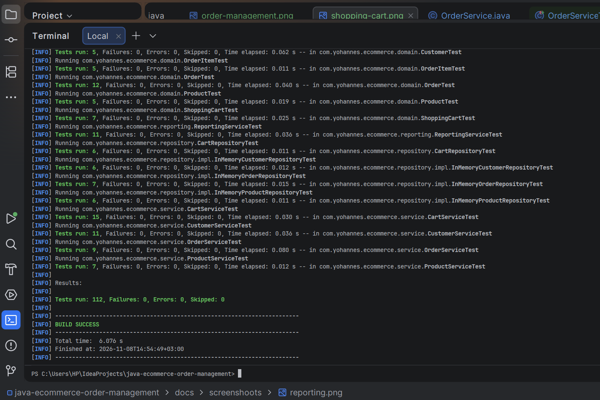

# E-Commerce Order Management System

A console-based E-Commerce Order Management System built with **Java 21 and Maven**, following layered architecture and professional object-oriented design principles.

The project simulates essential e-commerce operations, including product management, customer management, shopping carts, order processing, inventory management, and business reporting.

This project is being developed incrementally, with the goal of evolving it into a professional, database-backed backend application.

## Project Overview

The E-Commerce Order Management System provides a structured way to manage the core operations of an online shopping platform.

The application currently uses in-memory repositories and a console-based interface. Its architecture is designed to support future database integration without requiring major changes to the business logic.

## Features

### 1. Product Management
- Create and manage products.
- Retrieve products by ID.
- Update product prices.
- Update product stock quantities.
- Activate and deactivate products.
- Prevent duplicate product IDs.

### 2. Customer Management
- Register customers.
- Retrieve customer information.
- List registered customers.
- Update customer names and email addresses.
- Activate and deactivate customer accounts.
- Prevent duplicate customer IDs and email addresses.

### 3. Shopping Cart Management
- Create shopping carts for customers.
- Add products to shopping carts.
- Automatically merge duplicate products.
- Update product quantities.
- Remove products from carts.
- Calculate cart totals.
- Clear shopping carts.

### 4. Order Management
- Place orders using shopping cart contents.
- Validate customer and product availability.
- Check product stock before placing orders.
- Automatically update inventory after successful orders.
- Manage order lifecycle:
    - PLACED
    - CONFIRMED
    - SHIPPED
    - DELIVERED
    - CANCELLED
- Cancel eligible orders and restore inventory.
- Retrieve orders by ID and customer.

### 5. Reporting and Analytics
- Calculate total revenue.
- Count total orders.
- Generate order statistics by status.
- Identify best-selling products.
- Calculate revenue by product.
- Identify top customers by spending.
- Find low-stock products.
- Generate customer order statistics.

### 6. Exception Handling and Validation
- Custom exception hierarchy.
- Centralized validation utilities.
- Input validation and business rule enforcement.
- Meaningful exceptions for missing resources, duplicate resources, and invalid business operations.

## Architecture

The application follows a layered architecture that separates business logic, data access, domain models, and user interaction.

```text
src/
└── main/
    └── java/
        └── com/yohannes/ecommerce/
            │
            ├── domain/
            │
            ├── repository/
            │   └── impl/
            │
            ├── service/
            │
            ├── exception/
            │
            ├── validation/
            │
            ├── reporting/
            │
            ├── console/
            │
            └── Main.java
```

### Layer Responsibilities

| Layer | Responsibility |
|---|---|
| Domain | Represents business entities and their invariants. |
| Repository | Defines data access contracts. |
| Repository Implementation | Provides in-memory data storage. |
| Service | Implements business logic and application operations. |
| Exception | Defines application-specific exceptions. |
| Validation | Provides reusable input validation utilities. |
| Reporting | Generates business reports and analytics. |
| Console | Handles user interaction. |

## Technologies Used

- **Java 21** – Primary programming language.
- **Maven** – Build and dependency management.
- **JUnit 5** – Automated unit testing.
- **Git** – Version control.
- **GitHub** – Source code hosting and collaboration.
- **BigDecimal** – Accurate monetary calculations.

## Engineering Practices

This project applies several professional software engineering practices:

- Object-Oriented Programming (OOP).
- SOLID design principles.
- Separation of Concerns.
- Layered Architecture.
- Repository Pattern.
- Service Layer Pattern.
- Dependency Injection through constructors.
- Encapsulation and immutability where appropriate.
- Custom exception handling.
- Centralized input validation.
- Automated unit testing.
- Git feature branches and pull requests.

## Getting Started

### Prerequisites

Make sure you have installed:

- Java Development Kit (JDK) 21 or later.
- Apache Maven.
- Git.

### Clone the Repository

```bash
git clone https://github.com/yohannesasch/java-ecommerce-order-management.git
```

### Navigate to the Project

```bash
cd java-ecommerce-order-management
```

### Build the Project

```bash
mvn clean install
```

### Run the Application

```bash
mvn exec:java -Dexec.mainClass="com.yohannes.ecommerce.Main"
```

### Run Tests

```bash
mvn clean test
```

## Application Screenshots

Screenshots demonstrating the application's functionality are available below.

### Main Menu


### Product Management


### Customer Management


### Shopping Cart


### Order Management


### Reporting and Analytics


### Test Results


## Project Development Roadmap

### Version 1 — Core E-Commerce System (Completed)

- [x] Domain modeling.
- [x] Repository layer.
- [x] Service layer.
- [x] Product management.
- [x] Customer management.
- [x] Shopping cart management.
- [x] Order management and lifecycle.
- [x] Inventory management.
- [x] Reporting and analytics.
- [x] Console application.
- [x] Custom exception handling.
- [x] Centralized validation.
- [x] Automated unit testing.

### Version 2 — Professional MySQL Integration (Planned)

- [ ] MySQL database design and schema.
- [ ] JDBC integration.
- [ ] Database-backed repository implementations.
- [ ] HikariCP connection pooling.
- [ ] Transaction management and rollback.
- [ ] Database indexing and performance optimization.
- [ ] Database security.
- [ ] Integration and concurrency testing.

### Future Development

- Spring Boot REST API.
- Authentication and authorization.
- API documentation.
- Docker containerization.
- Deployment.

## Author

**Yohannes Aschalew**

Software Engineering Student | Java Backend Developer in Progress

GitHub: [@yohannesasch](https://github.com/yohannesasch)

## License

This project is licensed under the MIT License.
See the [LICENCE](LICENCE) file for details.